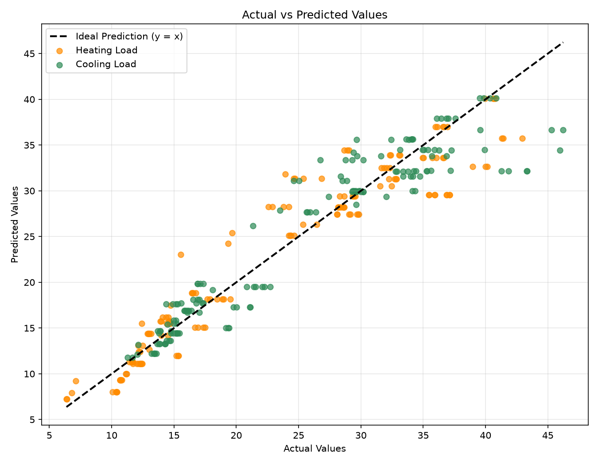

# Predict Energy Efficiency

AI101 mini-project that uses multiple linear regression to predict heating and cooling loads from building design data.

## Team and responsibilities

| Component lead | Team member | Entry No. and handle | Contribution |
|---|---|---|---|
| Documentation | Damera Vyshali | [@2026eeb1338](https://github.com/2026eeb1338) | Data visualisation, Project documentation and README |
| Execution | Sahittya Dutta | [@2026esb1491](https://github.com/2026esb1491-web) | Data preprocessing and training, Feature Selection, Requirements and execution instructions |
| PPT | Haral Anuradha Dnyaneshwar | [@2026aib1039](https://github.com/2026aib1039-coder) | Data testing and visualisation, Five-slide presentation |
| Video | Prathmesh Jamdade | [@2026mcb1555](https://github.com/PrathmeshAvadhutJamdade1555) | Data exploration, evaluation, Project structure and Project video |

**Group number:** 31

- **Public GitHub repository:** will add later
- **Project video:** will add later
- **Presentation:** will add later

## Project files

```textu
.
├── main.py
├── DATA_ANALYSIS.md
├── Mini_Project_Slides.pdf
├── VIDEO_SCRIPT.md
├── requirements.txt
├── data/
│   ├── ENB2012_data_CSV.csv
│   └── ENB2012_data.xlsx
└── outputs/
    ├── data_exploration_and_analysis/
    │   ├── data_exploration_output.txt
    │   ├── correlation_matrix.csv
    │   └── features_vs_targets.png
    └── prediction_results/
        ├── actual_vs_predicted.png
        ├── evaluation_metrics.txt
        └── test_predictions.csv
```

## Setup and run

The pinned dependencies are listed in `requirements.txt`. Use Python 3.10-3.12 (Python 3.11 is recommended). First clone the public repository and enter its folder.

```bash
git clone https://github.com/PrathmeshAvadhutJamdade1555/Predict-Energy-Efficiency.git
cd Predict-Energy-Efficiency
python --version
python -m venv .venv
```

Activate the environment, install the requirements, and run the script:

```powershell
# Windows PowerShell
.venv\Scripts\Activate.ps1
python -m pip install -r requirements.txt
python main.py
```

```bash
# macOS or Linux
source .venv/bin/activate
python -m pip install -r requirements.txt
python main.py
```

The program writes the dataset exploration log, correlation matrix, and feature-versus-target graph to `outputs/data_exploration_and_analysis/`. It writes test predictions, evaluation metrics, and the actual-versus-predicted plot to `outputs/prediction_results/`.

## Problem statement and motivation

Building design choices affect the energy needed to heat and cool indoor spaces. Estimating these loads early can help compare design options and identify choices associated with higher or lower demand before a building is constructed. This project uses the ENB2012 dataset to predict heating load and cooling load from building geometry and glazing measurements.

The task is a two-target regression problem: predict **Heating Load** and **Cooling Load** for a building configuration. The model is intended as a course project baseline on the supplied dataset, not as a substitute for a detailed building energy simulation.

## Dataset

The project uses the supplied ENB2012 Energy Efficiency dataset, also available from the [UCI Machine Learning Repository](https://archive.ics.uci.edu/dataset/242/energy+efficiency). It contains 768 rows, eight original input columns, and two target columns. The project CSV is `data/ENB2012_data_CSV.csv`; the original workbook is also included in `data/`.

The dataset variables use the following symbols, descriptions, units, and codes:

| Symbol | Variable | Description / values | Unit |
|---|---|---|---|
| X1 | Relative Compactness | Building volume-to-surface ratio compared with the most compact shape having the same volume | Dimensionless ratio |
| X2 | Surface Area | Total surface area | m² |
| X3 | Wall Area | Wall area | m² |
| X4 | Roof Area | Roof area | m² |
| X5 | Overall Height | Building height | m |
| X6 | Orientation | 2 = North; 3 = East; 4 = South; 5 = West | Dimensionless code |
| X7 | Glazing Area | Glazing as a percentage of floor area: 0%, 10%, 25%, or 40% | Dimensionless proportion |
| X8 | Glazing Area Distribution | 0 = No glazing; 1 = Uniform; 2 = North; 3 = East; 4 = South; 5 = West | Dimensionless code |
| Y1 | Heating Load | Heating energy load per unit floor area | kWh/m² |
| Y2 | Cooling Load | Cooling energy load per unit floor area | kWh/m² |

The CSV stores X7 as proportions (0, 0.10, 0.25, and 0.40); the table expresses these as percentages for readability.

## Analysis and modeling decisions

1. **Data inspection:** The code records its dimensions, column names, sample rows, data types, summary statistics, missing values, duplicate rows, and correlation matrix. This checks data quality and shows how the variables relate before modeling. The supplied data has 768 rows with no missing values or duplicate rows.
2. **Visualize feature relationships:** The exploration graph plots each of the eight original inputs against both load targets. This provides a visual check of the patterns in addition to the correlation matrix. The graph is saved before feature selection, so it includes all eight inputs.
3. **Feature Selection:** Orientation and Glazing Area Distribution were excluded because their Pearson correlations with the targets are weak in this dataset: Orientation is approximately -0.003 with Heating Load and 0.014 with Cooling Load; Glazing Area Distribution is approximately 0.087 and 0.051. The model retains Relative Compactness, Surface Area, Wall Area, Roof Area, Overall Height, and Glazing Area.
4. **Data Preparation:** Rows with missing target values are removed because supervised training requires known target values. Duplicate rows are removed so repeated records do not receive extra weight. The selected features and two targets are then separated.
5. **Standard Test-Train Split:** An 80/20 train/test split reserves unseen rows for evaluation. `random_state=42` makes the split repeatable.
6. **Data Preprocessing:** Feature types are detected from the selected columns. The six selected predictors are numeric, so they are median-imputed and standardized. A categorical preprocessing branch is configured for categorical columns if present; none of the selected predictors currently use it. Keeping preprocessing inside the pipeline ensures it is fitted as part of model training.
7. **Linear Regression:** `LinearRegression` predicts both targets from the same six building features. It provides a straightforward baseline for comparing predicted and actual loads.
8. **Testing:** MAE and RMSE summarize prediction errors; MSE is the squared-error measure; R2 summarizes the proportion of target variation explained on this split.

## Results

The saved evaluation output reports results for 154 test rows:

| Target | MAE | MSE | RMSE | R2 |
|---|---:|---:|---:|---:|
| Heating Load | 2.164 | 9.218 | 3.036 | 0.912 |
| Cooling Load | 2.201 | 9.954 | 3.155 | 0.893 |



## AI-use disclosure

OpenAI ChatGPT assisted with drafting the first iteration of this README.md, figure out a way to plot multiple graphs on one png.

Google Search was used to discover ANSI codes and how to print coloured text in terminal.

The project team assumes the responsibility for the code.
